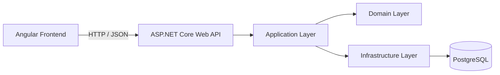

# Task Management

> .NET web app for task management

## 1 - Overview

Task Management is a web application that allows registered users to securely manage their personal tasks.

The main business goal is to provide a simple and intuitive way for users to create, track, update, and remove tasks.

**Business Requirements**

- Users must be able to register using a unique email address and password.

- Passwords must contain at least 6 characters.

- Authenticated users must be able to create, view, update, and delete their own tasks.

- Each task must have a title, due date, and status. Task descriptions are optional.

- Task statuses must be selected from a predefined set: To-do, Doing, Done, and Cancelled.

- The system must prevent unauthorized access to another user's tasks.

- The application should provide clear validation and error messages when business rules are not met.


The [User Stories Page](docs/user-stories.md) details user stories and their acceptance criteria describing the system behavior using Gherkin (BDD) format.


## 2 - Architecture

This project showcases separation of concerns, testability, API design, authentication, authorization, frontend integration and AI-assisted development.



**Architectural Decisions**

| Layer | Tech |
|---|---|
| Frontend | Angular |
| Backend | ASP.NET Core / C# |
| API | REST |
| Database | PostgreSQL |
| ORM | Entity Framework Core |
| Authentication | ASP.NET Core Identity |
| API authentication | JWT Bearer |

**Project structure**

```text
task-management/
│
├── backend/
│   ├── src/
│   │   ├── README.md
│   │   ├── backend files
│
├── frontend/
│   └── task-management-ui
│       ├── src/
│       │   ├── README.md
│       │   ├── frontend files
│
├── infrastructure/
│   ├── docker/
│   │   └── docker-compose.yml
│
├── docs/
│   ├── architecture.md
│   ├── user-story.md
│   └── ai/
│       ├── prompts.md
│
│── setup-and-run-app.ps1
└── README.md
```

For more details see the [Architecture Page](docs/architecture.md)


## 3 - Running the application

Prerequisites:

- .NET 9 SDK
- Node.js supported by Angular 18 (18.19.1+, 20.11.1+, or 22.0.0+)
- npm
- Docker with the Compose plugin (must be running)
- EF Core command-line tools 9.0.4 (will be installed automatically by the setup script if necessary)

From the repository root, run the `setup-and-run-app.ps1` to start PostgreSQL, install dependencies, configure a local JWT signing key and run the application:

```powershell
.\setup-and-run-app.ps1
```

The script opens the backend and frontend in separate terminal windows.

Since Angular server and API are running, open the application `http://localhost:4200` in the web browser.


## 4 - Demo credentials

TODO

## 5 - API

APIs are described in the [Backend Page](backend/src/README.md#api-endpoints)


## 6 - AI-assisted development

GitHub Copilot was used throughout the project for AI-assisted development, with a focus on improving productivity while maintaining engineering quality and control.

A set of structured AI prompts was also created to guide an LLM in generating the backend (.NET) and frontend (Angular) projects based on the requirements and architectural design described in `user-story.md` and `architecture.md`.

Custom skills were created and leveraged to generate automated tests from the user stories and their acceptance criteria.

AI tools were also used to accelerate the creation and refinement of project documentation, including readme files, and other supporting materials.

AI-generated code and documentation was treated as a development aid rather than a replacement for engineering decisions. The generated implementation was reviewed, refined, and validated.

For more information, see the AI prompt files located in the `docs/ai/prompts` directory, while the custom skills are located in the `.github/skills` folder.


## 7 - Backlog

- [ ] Run frontend and backend in container (using docker-compose)
- [ ] Add Node installation to setup-and-run-app.ps1 script
- [ ] Create integration tests in the backend project
- [ ] Admin user concept