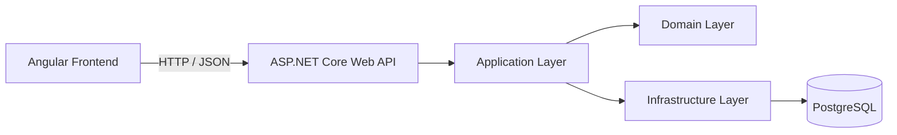

# Task Management

> .NET web app for task management

## Overview
Task Management is a web application that allows registered users to securely manage their personal tasks.

The main business goal is to provide a simple and intuitive way for users to create, track, update, and remove tasks.

**Business Requirements**

- Users must be able to register using a unique email address and password.

- Passwords must contain at least 6 characters.

- Authenticated users must be able to create, view, update, and delete their own tasks.

- Each task must have a title, due date, and status. Task descriptions are optional.

- Task statuses must be selected from a predefined set: To-do, Doing, Done, and Cancelled.

- The system must prevent unauthorized access to another user's tasks.

- The application should provide clear validation and error messages when business rules are not met.

## Architecture

Architectural Decisions
| Layer | Tech |
|---|---|
| Frontend | Angular |
| Backend | ASP.NET Core / C# |
| API | REST |
| Database | PostgreSQL |
| ORM | Entity Framework Core |
| Authentication | ASP.NET Core Identity |
| API authentication | JWT Bearer |

For more details see the [Architecture Page](docs/architecture.md)

## Prerequisites

- .NET 9 SDK
- Docker with the Compose plugin (must be running)
- EF Core command-line tools 9.0.4 (will be installed automatically by the setup script)

## Running the application

From the repository root, run the setup-and-run-app.ps1 to start PostgreSQL, install dependencies, configure a local JWT signing key and the application:

```powershell
.\setup-and-run-app.ps1
```
```

## Running tests

...

## Demo credentials

## API

APIs are described in the [Backend Page](backend/src/README.md)


## Project structure


## Architectural decisions

## AI-assisted development

## Known limitations
