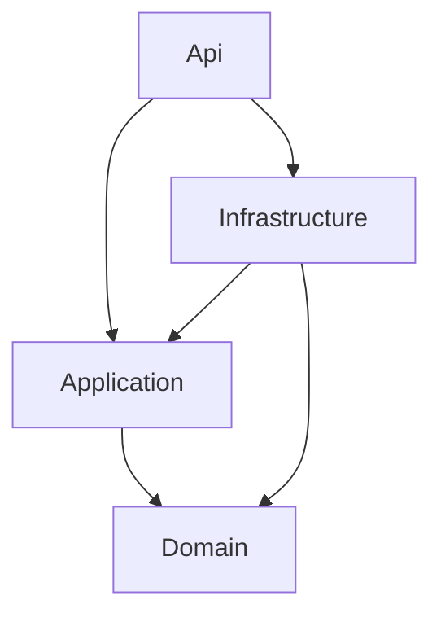

# Task Management Backend

> The backend uses Clean Architecture, PostgreSQL, Entity Framework Core, ASP.NET Core Identity, and JWT bearer authentication.


**Solution structure**

```text
backend/
└── src/
    ├── TaskManagement.Api/            # Controllers, middleware, Swagger, startup
    ├── TaskManagement.Application/    # DTOs, validation, and application services
    ├── TaskManagement.Domain/         # Entities and repository/unit-of-work contracts
    └── TaskManagement.Infrastructure/ # EF Core, PostgreSQL, Identity, JWT, migrations
    └── Tests/                         
        └── TaskManagement.UnitTests/  # Unit tests
```

The Compose database credentials are for local environment only.

The backend is organized according to Clean Architecture principles. Business rules are kept independent from the API and infrastructure concerns.




## Run locally

**Requirements**

- .NET 9 SDK
- Docker with the Compose plugin (must be running)
- EF Core command-line tools 9.0.4 (will be installed automatically by the setup script)

Run the following command from the repository root, it will create the environment and run the application. 

```powershell
.\setup-and-run-app.ps1
```

Open Swagger UI at `/swagger` on the local address (https://localhost:56029/swagger/)


## API endpoints

The API listens for the Angular development server at `http://localhost:4200`.

The `auth` routes are anonymous and `tasks` route requires access token like this:

```http
Authorization: Bearer <accessToken>
```

### Authentication routes (anonymous)

| Method | Route | Description |
|---|---|---|
| `POST` | `/api/auth/register` | Register with a unique email and a password of at least 6 characters. |
| `POST` | `/api/auth/login` | Authenticate and receive an access token and its expiration time. |

Example registration/login request:

```json
{
  "email": "user@example.com",
  "password": "example-password"
}
```

The login response contains `accessToken` and `expiresAt`.

### Tasks routes (bearer token required)

| Method | Route | Description |
|---|---|---|
| `GET` | `/api/tasks/` | List the authenticated user's tasks, ordered by due date. |
| `POST` | `/api/tasks` | Create a task for the authenticated user. |
| `GET` | `/api/tasks/{id}` | Retrieve one of the authenticated user's tasks. |
| `PUT` | `/api/tasks/{id}` | Update one of the authenticated user's tasks. |
| `DELETE` | `/api/tasks/{id}` | Delete one of the authenticated user's tasks. |
| `GET` | `/api/tasks/status` | List all available task statuses. |

Tokens expire after 30 minutes.

### Health check

Health check endpoint checks application and database health. It's available at `/health`


## Running tests

From `backend\src` directory, run:

```powershell
dotnet test
```

This builds the solution and runs the automated .NET tests.


<details>
<summary>About Collect code coverage</summary>

The test project uses Coverlet to collect code coverage. 
Run:

```powershell
dotnet test --collect:"XPlat Code Coverage"
```

The coverage result is written as a `coverage.cobertura.xml` file under a generated `TestResults` directory in the test project.

To generate an HTML coverage report, install the ReportGenerator global tool once:

```powershell
dotnet tool install -g dotnet-reportgenerator-globaltool
```

Then run the tests and generate the report from the backend repository root:

```powershell
dotnet test --collect:"XPlat Code Coverage"
reportgenerator `
  -reports:"tests/**/TestResults/**/coverage.cobertura.xml" `
  -targetdir:"TestResults/CoverageReport" `
  -reporttypes:Html
```

Open `TestResults/CoverageReport/index.html` to view the report.

</details>


