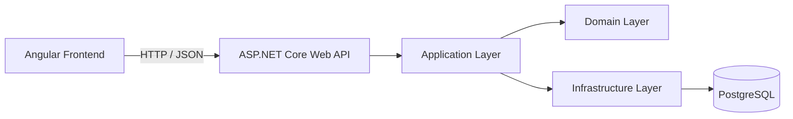
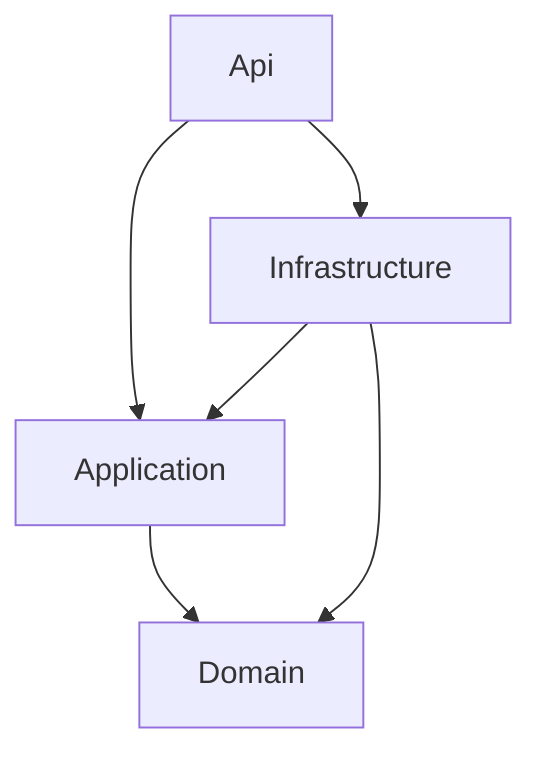
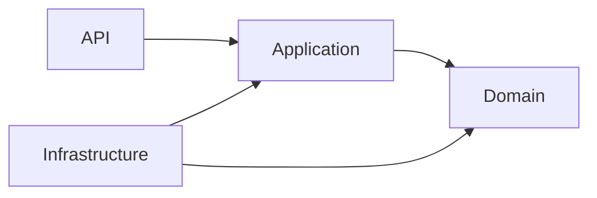
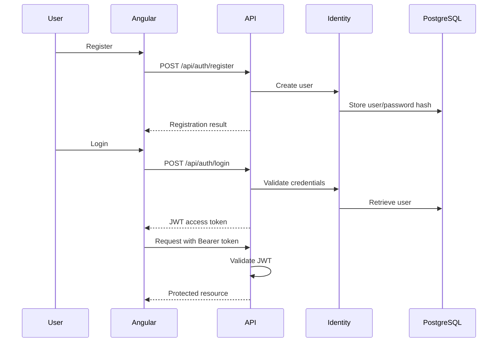
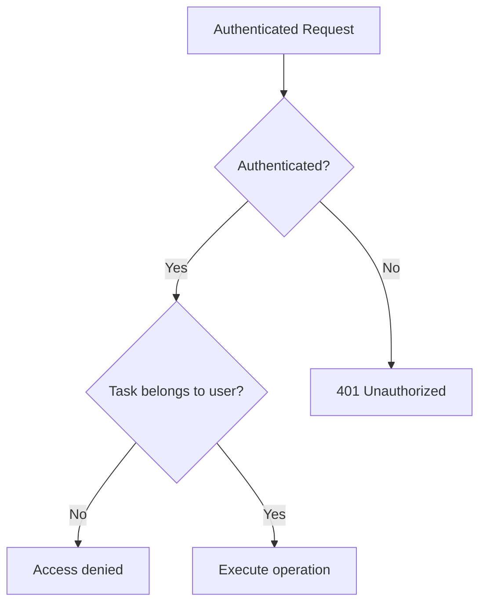
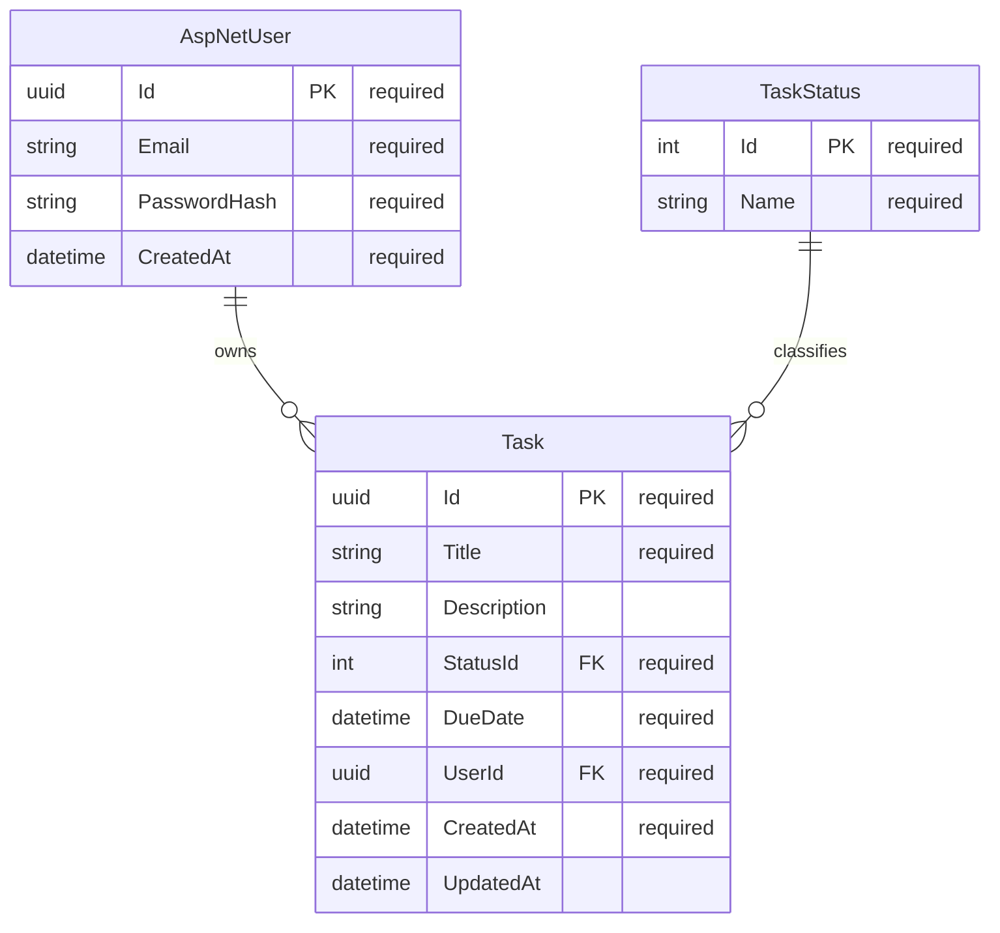
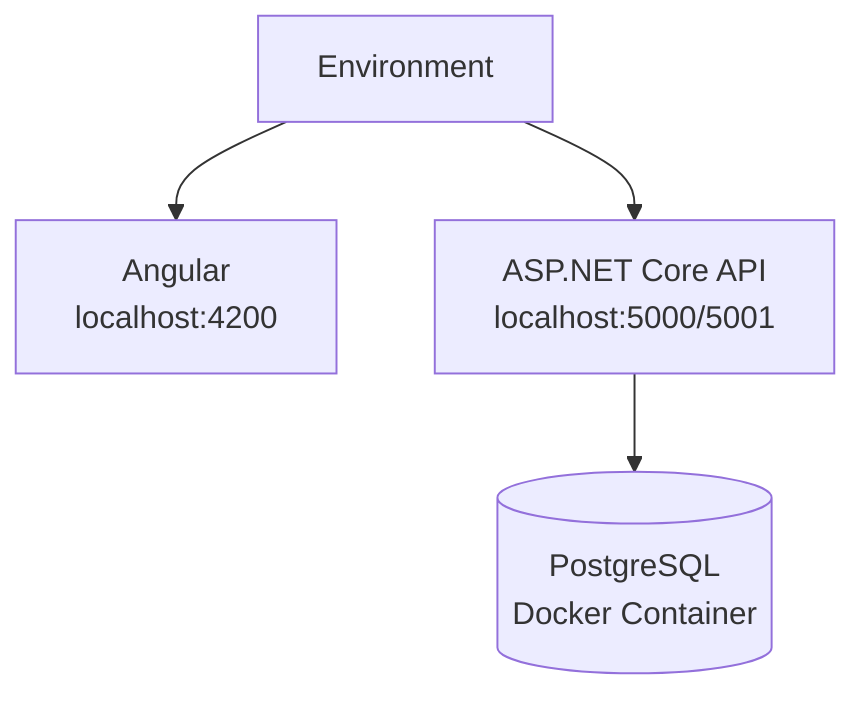

# Architecture

## Overview

>  This project is a simple task management web application.

The solution follows **Clean Architecture** principles and is composed of:

- **Angular** frontend
- **ASP.NET Core Web API** backend
- **PostgreSQL** database
- **Entity Framework Core** for data access and database schema migrations
- **ASP.NET Core Identity** for user management and authentication
- **JWT Bearer Authentication** for securing API endpoints
- **Docker Compose** for running the local PostgreSQL database

The application is intentionally designed to run locally without dependencies on cloud services. 

The main goal is to keep the solution simple and maintainable while demonstrating separation of concerns, testability, API design, authentication, authorization, and frontend integration.

---

## Architecture Overview



The frontend communicates exclusively with the backend through HTTP/REST APIs.

The backend is organized according to Clean Architecture principles. Business rules are kept independent from the API and infrastructure concerns.

---

## Solution Structure

The repository is organized into three main areas:

```text
task-management/
│
├── backend/
│   ├── src/
│   │   ├── TaskManagement.Api/
│   │   ├── TaskManagement.Application/
│   │   ├── TaskManagement.Domain/
│   │   └── TaskManagement.Infrastructure/
│   │   │
│   │   └── tests/
│   │       ├── TaskManagement.UnitTests/
│   │       ├── TaskManagement.IntegrationTests/
│
├── frontend/
│   └── task-management/
│
├── infrastructure/
│   ├── docker/
│   │   └── docker-compose.yml
│   
│
├── docs/
│   ├── architecture.md
│   ├── user-story.md
│   └── ai/
│       ├── prompts.md
│
└── README.md
```

The `infrastructure` directory contains files related to overall local environment.

---

# Clean Architecture

The backend follows a simplified Clean Architecture approach with four projects:



### Domain (R)

The Domain layer contains the core business entities and rules.

Examples:

- `Task`
- `TaskStatus`
- domain validations and business rules

The Domain layer should not depend on ASP.NET Core, Entity Framework Core, PostgreSQL, or Angular.

---

### Application (R)

The Application layer contains the application's use cases and business logic.

Examples:

- Register user
- Login
- Create task
- Get tasks
- Get task
- Update task
- Delete task


---

### Infrastructure (R)

The Infrastructure layer contains implementations for external concerns, such as:

- Entity Framework Core
- PostgreSQL access
- ASP.NET Core Identity persistence
- repository/data access implementations
- database migrations

Infrastructure implements abstractions required by the Application layer.

---

### API (R)

The API layer is responsible for exposing the application's functionality through HTTP endpoints.

Its responsibilities include:

- HTTP request/response handling
- authentication configuration
- authorization
- model binding
- DTO mapping
- HTTP status codes
- API endpoint definitions

Business rules should not be implemented directly in controllers.

---

# Dependency Direction (R)

The main architectural rule is that inner layers should not depend on outer infrastructure concerns.



The Domain layer is the most independent part of the application.

The Application layer depends on Domain abstractions and contains the application's use cases.

The API and Infrastructure layers are implementation details around the application core.

---

# Authentication and Authorization

Authentication is implemented using **ASP.NET Core Identity** and **JWT Bearer Authentication**.

Users can register themselves and subsequently log in. Authentication sessions must expire after 30 minutes.

The authentication flow is:



Passwords are handled by ASP.NET Core Identity and are not stored as plain text. (R)

The JWT identifies the authenticated user. The user's identity is then used to determine which tasks the user is allowed to access. (R)

The application does not introduce administrative roles because user administration is outside the scope of the technical exercise. The authorization model is intentionally simple:

> An authenticated user can only manage their own tasks.

---


Conceptually: (R) ?




---

# Data Model

PostgreSQL is used as the relational data store.

A relational database was selected because the application has a simple relational domain, particularly the relationship between users and tasks. (R)

The main application entities are:



The existing statuses are:

| Id | Name |
|---:|---|
| 1 | To-do |
| 2 | Doing |
| 3 | Done |
| 4 | Cancelled |


---

# Database Schema Management

EF Core Migrations were selected for this technical exercise to manage database schema changes because they provide a simple and integrated way to manage the database schema in a local environment.

For a production environment, database schema changes would typically be integrated into the deployment pipeline using a controlled migration strategy, such as reviewed SQL migration scripts or migration bundles. A dedicated database deployment tool such as DbUp could also be considered depending on the organization's deployment practices.

---

# Infrastructure

I intentionally kept the infrastructure local because the objective is to demonstrate software architecture, clean code, testing and API design rather than cloud infrastructure.

PostgreSQL runs containerized using Docker Compose.



Docker is used for the database to provide a consistent and reproducible local development environment. (R)

The goal is that a developer or interviewer can clone the repository, start the required infrastructure, apply the database migrations, and run the application locally without requiring access to AWS, Azure, or other cloud services. (R)

---

# Testing Strategy (Review)

The project follows a testing approach aligned with the exercise's TDD preference.

Tests are organized according to the application layers.

### Domain Tests

Verify domain rules and validations without requiring external dependencies.

### Application Tests

Verify use cases and business logic using mocked or test implementations of dependencies.

### API Tests

Verify API behavior, including:

- HTTP status codes
- request validation
- authentication requirements
- authorization
- API responses

The goal is to keep business logic highly testable and avoid coupling tests to infrastructure whenever it is unnecessary.

---

# Architectural Decisions

The following decisions were intentionally made to keep the solution focused on the requirements of the technical exercise.

| Decision | Choice | Reason |
|---|---|---|
| Frontend | Angular | Familiarity and suitable for the required CRUD UI |
| Backend | ASP.NET Core / C# | Required by the exercise |
| API | REST | Simple and appropriate for the CRUD requirements |
| Architecture | Clean Architecture | Required by the exercise and improves separation of concerns |
| Database | PostgreSQL | Relational model fits the domain and runs easily in Docker |
| ORM | Entity Framework Core | Native .NET integration and productivity |
| Authentication | ASP.NET Core Identity | Provides secure user management without introducing another service |
| API authentication | JWT Bearer | Appropriate for a stateless REST API |
| Authorization | User/resource ownership | Satisfies the application's security requirement without unnecessary RBAC |
| Database migrations | EF Core Migrations | Simple and integrated for this exercise |
| Cloud | None | Keeps the solution locally reproducible and focused on the exercise |
| Containers | Docker Compose | Provides reproducible local PostgreSQL infrastructure |

---

# Scope and Deliberate Simplifications

This solution intentionally does not introduce:

- administrative users or RBAC;
- external identity providers;
- cloud infrastructure;
- API gateway;
- Refresh-token rotation or blacklist


The architecture is therefore designed to demonstrate sound engineering principles while remaining small enough to understand, test, run, and review easily.